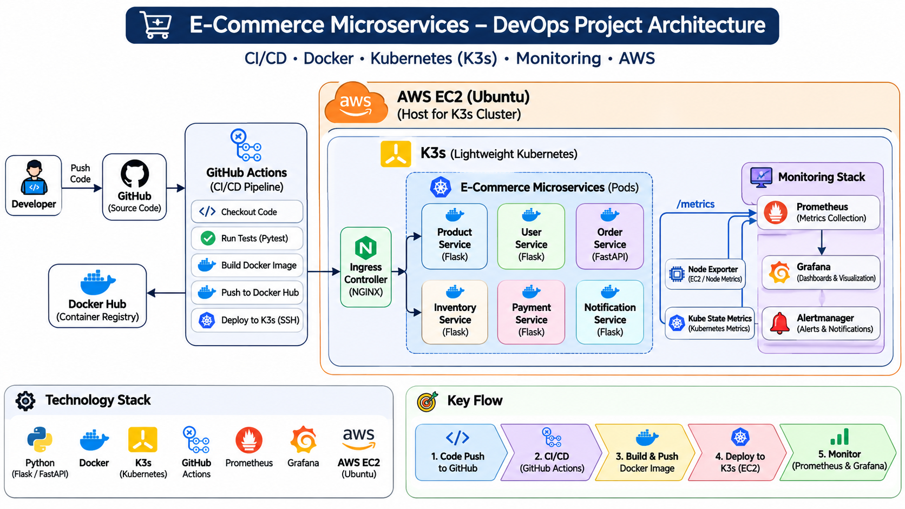

# E-Commerce Microservices – End-to-End DevOps Project

## 1. Project Overview

This project demonstrates an end-to-end DevOps implementation for a Python-based E-Commerce Microservices application.

The application consists of six independent microservices, containerized using Docker and deployed using Kubernetes (K3s).

The infrastructure is provisioned using Terraform on AWS EC2. Continuous Integration and Continuous Deployment (CI/CD) are automated using GitHub Actions. Prometheus and Grafana provide application and infrastructure monitoring.

**Project Objective:** To implement a practical DevOps workflow covering infrastructure provisioning, containerization, orchestration, CI/CD automation, application deployment, and monitoring.

## 2. Project Architecture

The following diagram illustrates the end-to-end DevOps architecture, including CI/CD automation, Docker containerization, Kubernetes deployment, AWS infrastructure, and monitoring.



## 3. Technology Stack

| Category | Technology |
|---|---|
| Cloud Platform | AWS EC2 |
| Infrastructure as Code | Terraform |
| Operating System | Ubuntu Linux |
| Containerization | Docker |
| Container Registry | Docker Hub |
| Orchestration | Kubernetes (K3s) |
| CI/CD | GitHub Actions |
| Programming Language | Python |
| Application Frameworks | Flask, FastAPI |
| Testing | Pytest |
| Code Formatting | Black |
| Monitoring | Prometheus, Grafana |
| Package Management | Helm |
| Version Control | Git, GitHub |

## 4. Application Microservices

The application consists of six independent Python-based microservices.

| Microservice | Framework | Port |
|---|---|---:|
| Product Service | Flask | 5001 |
| User Service | Flask | 5000 |
| Order Service | FastAPI | 8000 |
| Inventory Service | Flask | 5003 |
| Payment Service | Flask | 5006 |
| Notification Service | Flask | Configured port |

### Service Responsibilities

- **Product Service:** Manages product information and product APIs.
- **User Service:** Handles user-related operations.
- **Order Service:** Handles order processing and communication with other services.
- **Inventory Service:** Manages inventory information.
- **Payment Service:** Handles payment-related operations.
- **Notification Service:** Handles application notifications.

## 5. Infrastructure Provisioning – Terraform

Terraform is used to provision and manage AWS infrastructure.

Implemented configurations include:

- AWS provider configuration.
- Ubuntu AMI selection.
- EC2 instance provisioning.
- Security group configuration.
- Infrastructure management using Terraform.

## 6. Containerization – Docker

Each microservice is containerized independently using Docker.

Implemented activities include:

- Created Dockerfiles for individual microservices.
- Built Docker images.
- Tagged and versioned container images.
- Published images to Docker Hub.
- Used Docker Compose for local development and testing.

## 7. Kubernetes Deployment – K3s

The six microservices are deployed using K3s, a lightweight Kubernetes distribution.

Kubernetes configurations and hands-on activities include:

- Deployments and ReplicaSets.
- ClusterIP and NodePort Services.
- ConfigMaps and Secrets.
- Readiness and Liveness Probes.
- Resource Requests and Limits.
- Horizontal Pod Autoscaling (HPA).
- Ingress Controller and routing.
- TLS configuration.
- Role-Based Access Control (RBAC).
- Helm-based deployments.

## 8. CI/CD Automation – GitHub Actions

GitHub Actions automates the application build, testing, container image publishing, and deployment workflow.

### Pipeline Workflow

1. Checkout application source code.
2. Configure Python environment.
3. Install application dependencies.
4. Execute automated tests using Pytest.
5. Perform code formatting checks using Black.
6. Build Docker images.
7. Push Docker images to Docker Hub.
8. Deploy updated application images to the Kubernetes environment using SSH-based automation.

### Additional CI/CD Features

- Dependency caching.
- Matrix builds.
- Workflow artifacts.
- Environment-based deployment configuration.
- Automated Docker image publishing.
- SSH-based deployment automation.

## 9. Monitoring – Prometheus and Grafana

Prometheus and Grafana are used to monitor the microservices environment.

The monitoring stack is deployed using Helm in the Kubernetes environment.

Implemented activities include:

- Prometheus metrics collection.
- Grafana integration with Prometheus as a data source.
- Product Service availability dashboard.
- Visualization of application availability and monitoring metrics.

## 10. Key DevOps Concepts

- Infrastructure as Code (IaC).
- Containerization and image management.
- Kubernetes orchestration.
- CI/CD pipeline automation.
- Automated application testing.
- Container image versioning.
- Kubernetes health checks.
- Configuration and secrets management.
- Rolling updates.
- Application monitoring.
- Deployment troubleshooting.

## 11. Repository Structure

The following structure represents the main project directories and files.

```text
ecommerce-microservices/
│
├── .github/
│   └── workflows/
│
├── api-gateway/
│
├── infrastructure/
│
├── k8s/
│
├── monitoring/
│
├── scripts/
│
├── services/
│   ├── product-service/
│   ├── user-service/
│   ├── order-service/
│   ├── inventory-service/
│   ├── payment-service/
│   └── notification-service/
│
├── docs/
│   ├── architecture.png
│   └── screenshots/
│
├── screenshots/
│
├── monitoring-values.yaml
├── README.md
└── .gitignore
```

## 12. Project Screenshots

Screenshots will demonstrate the actual implementation and successful execution of the DevOps project.

The following evidence will be added:

- GitHub Actions CI/CD pipeline execution.
- Docker Hub repositories and published images.
- AWS EC2 infrastructure.
- Kubernetes pods and services.
- Kubernetes deployment and ingress configuration.
- Prometheus monitoring targets.
- Grafana Product Service availability dashboard.

## 13. Learning Outcomes

Through this end-to-end project, I gained hands-on experience in:

- Provisioning cloud infrastructure using Terraform.
- Managing AWS EC2 infrastructure.
- Working with Linux and Bash scripting.
- Containerizing Python applications using Docker.
- Deploying microservices using Kubernetes (K3s).
- Building CI/CD pipelines using GitHub Actions.
- Managing container images using Docker Hub.
- Configuring Kubernetes networking and application health checks.
- Monitoring applications using Prometheus and Grafana.
- Troubleshooting infrastructure, container, and application deployment issues.

## 14. Author

**DevOps Project Portfolio**

**Technical Skills:** AWS | Terraform | Linux | Bash | Docker | Kubernetes | K3s | GitHub Actions | CI/CD | Prometheus | Grafana

**GitHub:** Add your GitHub profile URL.